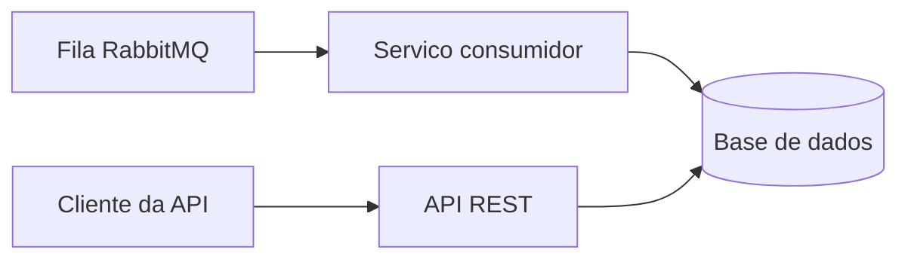

# Desafio Backend BTG Pactual

Aplicacao backend para receber pedidos por uma fila RabbitMQ, persistir os dados e disponibilizar consultas por meio de uma API REST.

> Projeto em desenvolvimento. As tecnologias, os endpoints e as instrucoes de execucao serao documentados conforme forem definidos e implementados.

## Objetivo

Implementar o processamento de pedidos em segundo plano e permitir consultar:

- O valor total de cada pedido.
- A quantidade de pedidos por cliente.
- Os pedidos realizados por cliente.

## Fluxo da solucao

O diagrama abaixo representa o fluxo funcional previsto. Os detalhes de infraestrutura e persistencia serao definidos durante a implementacao.



## Mensagem de pedido

O consumidor deve processar mensagens com o codigo do pedido, o codigo do cliente e seus itens:

```json
{
	"codigoPedido": 1001,
	"codigoCliente": 1,
	"itens": [
		{
			"produto": "lapis",
			"quantidade": 100,
			"preco": 1.10
		},
		{
			"produto": "caderno",
			"quantidade": 10,
			"preco": 1.00
		}
	]
}
```

O valor total do pedido e calculado pela soma de `quantidade * preco` de cada item. No exemplo acima, o total e `120.00`.

## Escopo

- [ ] Consumir pedidos de uma fila RabbitMQ.
- [ ] Persistir pedidos e itens em uma base de dados.
- [ ] Consultar o valor total de um pedido.
- [ ] Consultar a quantidade de pedidos por cliente.
- [ ] Listar os pedidos de um cliente.
- [ ] Disponibilizar a aplicacao e suas dependencias para execucao local, preferencialmente com Docker.
- [ ] Adicionar testes funcionais e documentar como executa-los.
- [ ] Documentar a arquitetura, a modelagem de dados e a implantacao.
- [ ] Registrar no relatorio tecnico o planejamento, o realizado, as tecnologias e eventuais desvios.

## Tecnologias

As tecnologias ainda serao escolhidas. O desafio permite utilizar Java, .NET ou Node.js e bancos relacionais ou MongoDB. A stack adotada e suas versoes serao registradas aqui quando a implementacao comecar.

| Componente          | Escolha   |
| ------------------- | --------- |
| Linguagem e runtime | A definir |
| API REST            | A definir |
| Banco de dados      | A definir |
| Mensageria          | RabbitMQ  |
| Ambiente local      | A definir |

## Como executar

As instrucoes de instalacao, configuracao e execucao serao adicionadas quando a estrutura da aplicacao estiver pronta.

## API

As rotas, parametros e exemplos de resposta serao documentados aqui depois de definidos. A API devera atender as consultas descritas em [Escopo](#escopo).

## Desenvolvimento

O plano de trabalho, incluindo tarefas e estimativas, sera acompanhado junto a implementacao. A entrega final tambem incluira evidencias dos testes funcionais e um relatorio tecnico com as decisoes e os diagramas da solucao.
